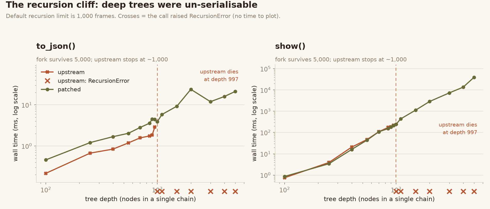
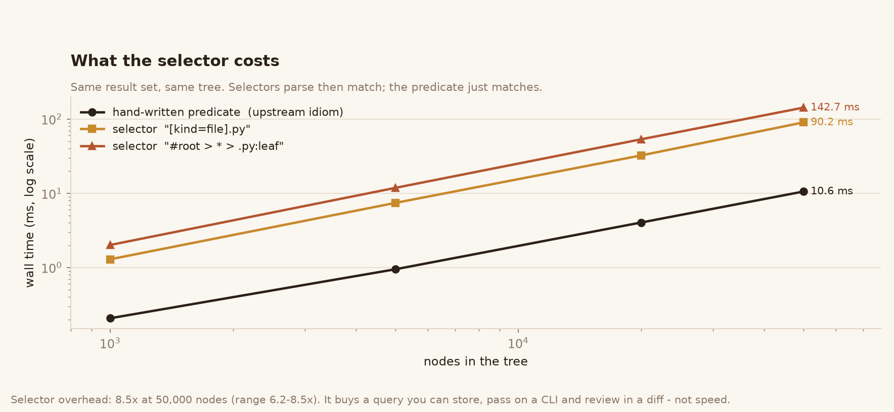
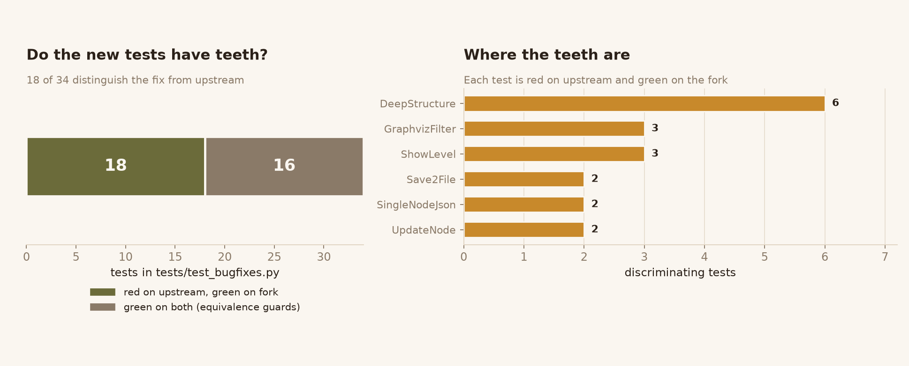

# treelib-toolkit

> A fork of [`treelib`](https://github.com/caesar0301/treelib) that keeps the
> original tree API intact and adds the four things every real tree project ends
> up writing by hand: **a query language, a structural diff, a validator, and
> renderers that go somewhere other than a terminal.**

`treelib` gives you a solid tree data structure — O(1) lookup, DFS/BFS/ZigZag
traversal, subtree operations. What it does not give you is a way to *ask
questions about* a tree, *compare* two versions of one, *check* that it is not
corrupt, or *put it on screen* somewhere other than stdout.

This fork adds exactly that, and fixes the defects found while building it.
The original API is untouched: all 211 upstream tests still pass unchanged.

```bash
pip install -e .
python -m treelib show tree.json
python -m treelib query tree.json "*.py:leaf" --count
python -m treelib diff old.json new.json --exit-code
python -m treelib convert tree.json --to html -o tree.html
```



*Measured, not estimated: upstream raises `RecursionError` at depth 997 (the
default 1,000-frame limit); this fork serialises a 5,000-node chain. Crosses mark
calls that never returned a result. Raw numbers in
[`docs/figures/data/recursion.json`](docs/figures/data/recursion.json).*

---

## Contents

- [What is new](#what-is-new)
- [Query language](#1-query-language--treequery)
- [Structural diff](#2-structural-diff--treelibdiff)
- [Integrity validation](#3-integrity-validation--treelibintegrity)
- [Renderers](#4-renderers--treelibrender)
- [Text round-trip](#5-text-round-trip--treelibtextparse)
- [Command line](#6-command-line--python--m-treelib)
- [Defects fixed](#defects-fixed)
- [Compatibility](#compatibility)
- [Testing](#testing)
- [Licence](#licence)

---

## What is new

| Area | Module | What it gives you |
|---|---|---|
| Query | `treelib.query` | CSS-style selectors: `*.py:leaf`, `#root > *`, `[size>0]`, `:has(Error)` |
| Diff | `treelib.diff` | `add` / `remove` / `move` / `update` between two trees, replayable |
| Validate | `treelib.integrity` | detects cycles, orphans, dangling pointers, backlink mismatches |
| Render | `treelib.render` | Markdown, Mermaid, DOT, self-contained interactive HTML |
| Parse | `treelib.textparse` | reads back the layout that `Tree.show()` prints |
| CLI | `treelib.cli` | `show` / `query` / `stats` / `diff` / `validate` / `convert` |

Everything is dependency-free (standard library only) and Python 3.7+
compatible, matching upstream.

---

## 1. Query language — `tree.query()`

`treelib` traversal takes a Python callback. That is fine inside one function and
useless everywhere else: it cannot be put in a config file, passed on a command
line, or reviewed in a diff. Selectors can.

```python
from treelib import Tree

tree = Tree()
tree.create_node("project", "root", data={"kind": "dir"})
tree.create_node("src", "src", parent="root", data={"kind": "dir"})
tree.create_node("main.py", "main", parent="src", data={"kind": "file", "size": 120, "classes": "py entry"})
tree.create_node("util.py", "util", parent="src", data={"kind": "file", "size": 40, "classes": "py"})
tree.create_node("draft.py", "draft", parent="src", data={"kind": "file", "size": 0, "classes": "py draft"})

tree.query("*.py").ids                     # ['main', 'util', 'draft']
tree.query("*.py:leaf").ids                # ['main', 'util', 'draft']
tree.query("[size=0]").ids                 # ['draft']
tree.query("#root > *").ids                # ['src']
tree.query("[kind=dir]:has(*.py)").ids     # ['root', 'src']
tree.query("*:not(.draft)").ids            # everything except draft.py
```

### Grammar

```
selector-list := selector ("," selector)*
selector      := compound (combinator compound)*
combinator    := ">" | "+" | "~" | <whitespace>
compound      := simple+
simple        := "*" | tag | "#" ident | "." class
               | "[" attr (op value)? "]"
               | ":" pseudo ( "(" argument ")" )?
```

**Combinators**

| Syntax | Meaning |
|---|---|
| `A B` | `B` is a descendant of `A` |
| `A > B` | `B` is a direct child of `A` |
| `A + B` | `B` immediately follows `A` as a sibling |
| `A ~ B` | `B` follows `A` as any later sibling |

**Attribute operators** — `=`, `!=`, `^=`, `$=`, `*=`, `~=`, `|=`, and bare
presence (`[size]`). `~=` matches a whitespace-separated word, `|=` matches a
value or a value followed by `-`.

Attributes resolve against `node.data` first (mapping key or object attribute),
then the node itself — so `[tag]`, `[size]`, `[kind=file]` all work regardless of
whether payload is a dict or an object.

**Pseudo-classes** — `:root`, `:leaf`, `:branch`, `:expanded`, `:collapsed`,
`:first-child`, `:last-child`, `:only-child`, `:nth-child(an+b)`, `:has(sel)`,
`:not(sel)`, `:contains(text)`. `:has()` accepts a relative selector:
`:has(> x)`, `:has(+ x)`, `:has(~ x)`.

**Tag vs class and dots.** `main.py` is a legal `treelib` tag, so a dot inside a
tag run stays part of the tag. `*.py` still means "tag `*`, class `py`" because
`*` closes the tag run; `*.py.draft` means "class py AND class draft".

**Classes** live in `node.data["classes"]` (string or iterable). A node without
that key simply has no classes, so selectors work on plain trees.

### Results

`QueryResult` is iterable, sized, indexable and chainable:

```python
result = tree.query("*.py")

result.ids              # ['main', 'util', 'draft']   document order
result.tags             # ['main.py', 'util.py', 'draft.py']
result.attr("size")     # [120, 40, 0]
result.first.tag        # 'main.py'
"main" in result        # True
result.query(":leaf")   # narrow further, inside the matched subtrees
result.filter(lambda n: n.get_attribute("size") > 0)

result.to_tree().show() # a real Tree, ancestors kept as "name (…)" placeholders
```

`to_tree()` is what makes results composable: the output is a genuine `Tree`, so
every existing method — `show()`, `to_json()`, `save2file()`, `to_graphviz()` —
works on it without conversion.

### What it costs



*Same tree, same result set, 50,000 nodes: a hand-written predicate takes
10.6 ms, a selector 90.2 ms — about **8.5× slower** (6.2–8.5× across sizes). The
overhead buys a query you can store in a config file, pass on a command line and
review in a diff; it does not buy speed. For a hot loop over a huge tree, keep
the predicate.*

---

## 2. Structural diff — `treelib.diff`

Comparing `to_json()` strings tells you *that* something changed, not *what*.
Key order, insertion order and generated identifiers all produce false positives.

```python
from treelib.diff import diff, apply_patch

changes = diff(old_tree, new_tree)
changes.summary()      # {'add': 1, 'remove': 1, 'move': 1, 'update': 2}
print(changes.describe())
```

```
- a2
+ b2 (parent=b)
~ a1 moved: a -> b
* a: data {'v': 2} -> {'v': 99}
* b: tag 'b' -> 'B renamed'
```

Diffs are **replayable** — the diff doubles as a compact transport format:

```python
patched = apply_patch(Tree(old_tree, deep=True), changes)
diff(patched, new_tree)   # 0 changes
```

Properties that matter in practice:

- **Data comparison is structural.** `{"a": 1, "b": 2}` and `{"b": 2, "a": 1}`
  compare equal; list order does not.
- **Additions are parent-first**, so a patch replays without ordering hacks.
- **Removals come first**, so a patch never creates a duplicate identifier.
- `compare_data=False` compares tags and topology only — for payloads with
  volatile fields like timestamps.

---

## 3. Integrity validation — `treelib.integrity`

A tree can be corrupt without any exception: a bad `move_node` target, a
hand-edited `_nodes` dict, a shallow `paste` sharing node objects between trees.
The symptom is a hang or nonsense output far from the cause.

```python
from treelib.integrity import validate

report = validate(tree)
report.ok           # False if any error-severity problem
report.codes()      # ['backlink_mismatch', 'cycle', 'unreachable']
print(report.describe())
```

```
error   backlink_mismatch  b   listed as child of 'b' but its parent is 'a'
error   cycle              b   cycle detected below 'b'
```

Checks: single root, root present, parent pointers valid, child pointers valid,
backlinks agree, no duplicate children, no orphans, no cycles, all nodes
reachable. Every problem is reported, not just the first.

---

## 4. Renderers — `treelib.render`

`show()` targets a terminal; `to_graphviz()` needs Graphviz installed. Neither
helps when the tree must land in a README, a chat message, or a browser tab.

```python
from treelib import to_markdown, to_mermaid, to_dot, to_html, render

to_markdown(tree)                        # nested bullet list
to_mermaid(tree)                         # ```mermaid graph TD ... ```
to_dot(tree)                             # Graphviz source, as a string
to_html(tree, title="My Tree")           # one self-contained page
render(tree, "mermaid", direction="LR")  # dispatch by name
```

| Format | Target | Notes |
|---|---|---|
| `markdown` | GitHub / GitLab / docs | nested `-` list, round-trips via `parse_tree` |
| `mermaid` | GitHub, Notion, Obsidian | identifiers aliased to `n0…` so dots and quotes cannot break it |
| `dot` | Graphviz | same as `to_graphviz`, but returns a string and never prints |
| `html` | browser, e-mail, `file://` | no CDN, no external assets |

The HTML page is interactive: live filter box, expand/collapse all, per-node
collapse, depth-aware typography, zero horizontal overflow. Verified in a real
browser (filter, collapse, toggle) rather than only by string assertions.

All renderers share `filter`, `key`, `reverse`, `sorting`, `limit`,
`data_property` and `show_id`, so the same tree looks consistent in every
format. All of them are iterative — a 2,000-deep chain renders without touching
the recursion limit.

---

## 5. Text round-trip — `treelib.textparse`

`show()` and `save2file()` were output-only: a tree saved for review could not be
reopened.

```python
from treelib import parse_tree

text = tree.show(stdout=False)
same = parse_tree(text)
same.show(stdout=False) == text   # True
```

Works for every shipped `line_type` (`ascii`, `ascii-ex`, `ascii-exr`,
`ascii-em`, `ascii-emv`, `ascii-emh`), plus Markdown bullet lists and tab
indentation. Identifiers come from `tag[id]` when present (`show(idhidden=False)`),
otherwise from `slugify(tag)` with `-2`, `-3` suffixes for collisions.

---

## 6. Command line — `python -m treelib`

```bash
python -m treelib show tree.json                     # text tree
python -m treelib show tree.json -f mermaid          # any renderer
python -m treelib show tree.json --depth 2 --limit 50
python -m treelib query tree.json "*.py:leaf" --count
python -m treelib query tree.json "[kind=dir]" -f json
python -m treelib stats tree.json -f json
python -m treelib diff old.json new.json --exit-code
python -m treelib validate tree.json --exit-code
python -m treelib convert tree.json --to html -o tree.html
cat tree.json | python -m treelib stats -
```

| Command | Purpose |
|---|---|
| `show` | render as text / markdown / mermaid / dot / html |
| `query` | select nodes; output ids, json, text or any renderer |
| `stats` | nodes, depth, leaves, max fan-out, per-level counts |
| `diff` | structural diff; `--exit-code` for CI |
| `validate` | integrity check; `--exit-code` for CI |
| `convert` | rewrite a tree in another format |

Exit codes: `0` success, `1` differences/errors with `--exit-code`, `2` bad
input. Input format is inferred from the extension (`.json` → JSON, `.txt` /
`.tree` → indented layout, `-` → stdin JSON).

---

## Defects fixed

Every item below was reproduced against upstream `treelib` 1.8.0
(`caesar0301/treelib` @ `83b3b87`) before being fixed, and has a regression test
that fails on upstream and passes here.

| # | Defect | Symptom upstream | Fix |
|---|---|---|---|
| 1 | `to_dict` / `to_json` recursive | `RecursionError` at depth **997** (measured) | iterative two-pass build, depth-safe JSON encoder |
| 2 | `from_json` recursive | cannot read back a deep document | explicit-stack parser |
| 3 | `from_json` rejects single-node trees | `to_json()` emits `"Only"`, then `from_json` raises `AttributeError: 'str' object has no attribute 'items'` | accept the bare-string form |
| 4 | `save2file` appends and leaks handles | second call doubles the file; one open handle per line | render once, write once; `append=` is opt-in |
| 5 | `show(level=n)` crashes | `IndexError: list index out of range` | guard the empty ancestor-flag list |
| 6 | `to_graphviz(filter=…)` emits dangling edges | Graphviz rejects the file ("node not defined") | only emit edges whose both endpoints survived the filter |
| 7 | `update_node(identifier=…)` silently overwrites | renaming onto an existing id deletes the other node with no error | raise `DuplicatedNodeIdError`, leave the tree untouched |
| 8 | `show()` / `save2file()` recursive | `RecursionError` at depth **997** (measured) | iterative renderer, identical output |

Fix #7 was the dangerous one: `tree.update_node("a", identifier="b")` used to
remove node `b` from `_nodes` while its parent still pointed at `b` — a tree that
looks fine until you traverse it.

### Output is unchanged

The rendering rewrite is verified byte-for-byte against upstream: 192 lines of
`show()` / `to_dict()` / `to_json()` / traversal output across all six line
styles, sorting, reversing, filtering, subtree roots, collapsed nodes and Unicode
are **identical**. The only intentional difference is that `to_graphviz()` now
returns the DOT source instead of `None`.

---

## Compatibility

- **Upstream API unchanged.** All 211 upstream tests pass unmodified.
- **Python 3.7+**, standard library only (same as upstream).
- New behaviour is opt-in: no existing method changed signature except
  `save2file`, which gained `append=False` (the previous implicit behaviour).
- `Tree.query()` and `Node.get_classes()` / `has_class()` / `has_attribute()` /
  `get_attribute()` are additive.

---

## Testing

```
381 tests, all passing
├── 211  upstream suite, unmodified
└── 170  new
    ├── 34  test_bugfixes.py        one test per defect, each red on upstream
    ├── 29  test_query.py           grammar, every combinator, every pseudo-class
    ├── 35  test_diff_integrity.py  diff replay, corrupted trees
    ├── 35  test_render.py          all four renderers + text round-trip
    └── 37  test_cli.py             every subcommand, in-process and via -m
```

### Do the new tests have teeth?



*Every test in `test_bugfixes.py` was run against an untouched upstream copy. 18
fail there and pass here — those are the ones that actually pin a fix down. The
other 16 are equivalence guards: they must pass on **both**, because their job is
to prove the rewrite did not change existing output.*

Verification performed:

- **Red on upstream, green here.** Measured per test, not assumed: 18 of 34
  distinguish, 16 are guards, 0 are ambiguous
  ([`tests.json`](docs/figures/data/tests.json)).
- **Mutation testing: 18/18 killed.** Each mutation (removed collision check,
  inverted attribute operator, off-by-one `nth-child`, dropped `data` on `add`,
  missing `</li>`, …) makes at least one test fail.
- **Byte-identical rendering** against upstream across 192 output lines.
- **Browser check** for the HTML renderer: 6 nodes, filter → 2 matches, filter
  miss → 0, collapse all → nested lists hidden, expand all → restored, per-node
  toggle, 0 px horizontal overflow.
- **Project CI**: `flake8 --select=E9,F63,F7,F82` clean; `black --check` clean;
  all 8 example scripts run; wheel and sdist build; the wheel was installed into
  a fresh venv and exercised there.
- **Python 3.7 syntax** verified by parsing every file with
  `ast.parse(feature_version=(3, 7))`.

Figures are regenerated from the recorded JSON by
[`docs/figures/scripts/plot.py`](docs/figures/scripts/plot.py); the measurement
scripts next to it reproduce the JSON itself.

---

## Licence

Apache License 2.0, unchanged from upstream. `LICENSE` is the original file,
byte for byte. `NOTICE.md` records the origin and the list of modifications, as
Apache-2.0 §4(b) requires.

Original work Copyright (C) 2011 Brett Alistair Kromkamp, 2012-2025 Xiaming Chen
and other contributors. Modifications Copyright (C) 2026 treelib-toolkit
contributors.
